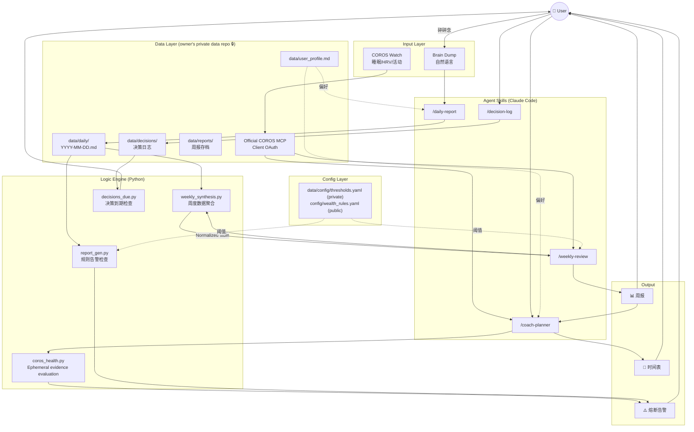
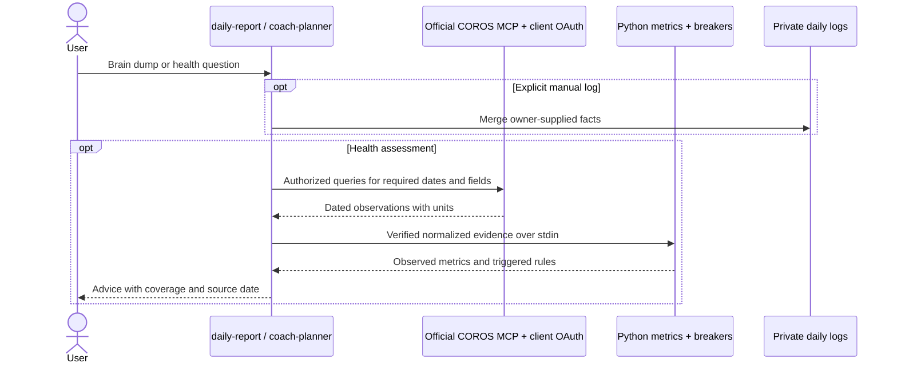
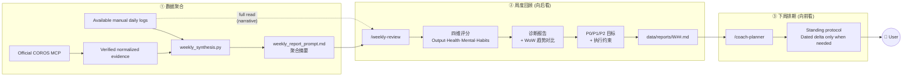
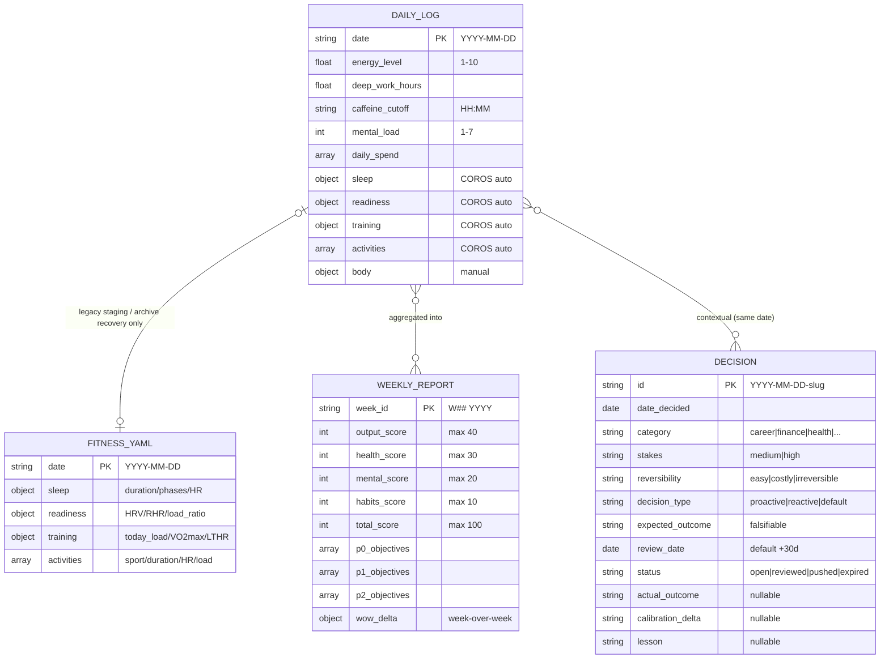
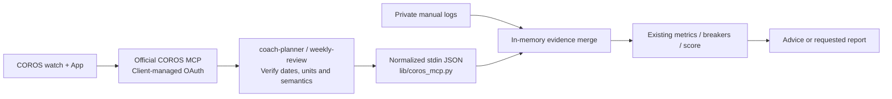
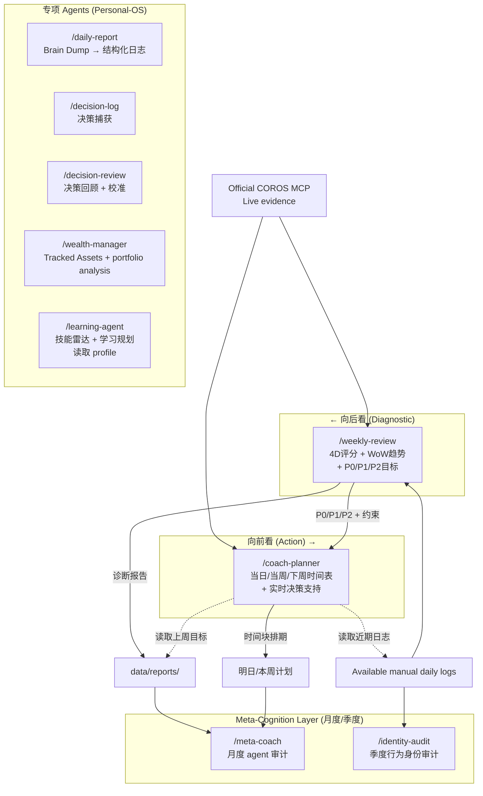
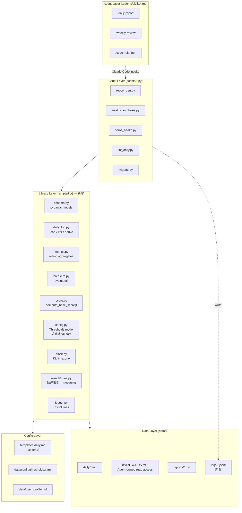

# Personal-OS — Architecture

Personal-OS 是单用户本地的数据驱动自我管理系统。核心闭环：optional manual context + official COROS MCP evidence → 逻辑引擎扫描触发熔断告警 → 周度聚合呈现有证据的指标与判据 → coach-planner 仅在例外出现时记录周度 delta。

**设计原则**：
- **人类可读优先** —— Markdown + YAML 作为存储介质，拒绝 SQLite/DB，保 `cat` + `grep` + 手改的工作流
- **职责分层** —— AI 负责 flexible narrative（评分解读、blocker 根因、排期叙事），代码负责 deterministic metrics（阈值判定、聚合、熔断）
- **本地单用户** —— 不做后台 cron / 托管部署 / 多租户；COROS uses client-managed OAuth MCP on demand; Calendar publication remains explicit
- **失败友好** —— 缺数据跳过而非崩溃；任何一天的日志残缺不影响其他天聚合

---

## 1. System Overview



> 说明：本架构图聚焦 Personal-OS 核心数据闭环。独立的专项 agent（wealth-manager 只读 `data/finance/` 并产出 Tracked Assets 报告；learning-agent 读取 profile、写入市场资料/报告）见 §7。

---

## 2. Daily Loop

Manual logging and live health assessment are independent. MCP queries require
no daily file and do not create one.




## 3. Weekly Loop

每周日的回顾与下周排期双循环。



> weekly-review queries official COROS MCP and passes normalized JSON to `make weekly COROS_INPUT=-`. Python merges health evidence with available manual logs in memory. The skill reads full manual prose separately; health-only weeks work without daily files. Plain `make weekly` is local-only; historical fitness YAML is not a live source.

---

## 4. Data Layer

仅列出核心闭环中的 persisted entities。配置（`data/config/thresholds.yaml`、`config/wealth_rules.yaml`、`data/user_profile.md`）和专项 agent 数据（`data/finance/`）不在此图。



---

## 5. Official COROS MCP

The [official setup guide](https://support.coros.com/hc/en-us/articles/50841795180948-Connect-Your-COROS-to-AI)
owns connection. Live device facts come from official MCP via client-managed OAuth.



`docs/design/coros-official-mcp.md` owns setup and normalization. Python validates
source, retrieval time, query period, unique dates and typed measurement fields.
MCP mode clears local health before merging official evidence; manual context
remains intact. Missing official fields never fall back to historical health.
Current-day breakers do not borrow earlier measurements. Partial sleep debt is
an observed lower bound, never proof of recovery.

The internal input is not COROS's wire schema. Actual connected tools must
establish units and semantics; an HRV normal range is not a scalar baseline,
and recovery percentage is not `tired_rate`. Unsupported mappings stay unknown.

`coros_health.py` evaluates evidence without daily/fitness writes.
`weekly_synthesis.py --coros-input -` preserves existing deterministic scoring,
ignored prompt and private event-log outputs. `make check`, plain `make weekly`
and `make report` inspect local recorded evidence, not current COROS readiness.
`sync_coros.py` is a fail-closed retirement stub. Legacy `patch_coros.py` and
fitness archive handling remain for historical recovery only; old logs/reports
are not migrated or overwritten.


## 6. Circuit Breakers

`report_gen.py` 独立遍历 `data/config/thresholds.yaml` 的 `circuit_breakers` 列表，按 metric + operator 匹配最近日志逐条判定 —— **没有显式 state machine**，每个 breaker 是独立规则，可同时触发多条。

| Breaker | Metric | Condition | 主要约束 (节选) |
|---------|--------|-----------|----------------|
| Sleep Critical | `sleep_duration` | 私有 `circuit_breakers` 规则 | 降低运动和工作负荷 |
| Sleep Debt L1 | `rolling_7d_sleep_debt` | 私有规则 | 限制训练强度 |
| Sleep Debt L2 | `rolling_7d_sleep_debt` | 私有规则 | 优先恢复 |
| Energy Collapse | `energy_level` | 私有规则 | 减少当日负荷 |
| Mental Overload | `mental_load` | 私有规则 | 缩小任务范围 |
| Consecutive Poor Sleep | `consecutive_poor_sleep` | 私有规则 | 安排恢复日 |
| HRV Recovery Alert | `hrv` | 私有规则 | 限制高强度训练 |
| Spending Surge | `single_transaction` | 私有规则 | 核对额外支出 |
| Overtraining Warning | `load_ratio` | 私有规则 | 调整训练量 |

完整 `actions` 列表见 `data/config/thresholds.yaml` 的 `circuit_breakers` 块。

**Null-safe 判定**：`report_gen.py` 与 `weekly_synthesis.py` 在 `actual is None` 时**跳过该 breaker**（而非 default 0），避免缺数据日（尤其 HRV 未同步时）产生 false positive。

**Poor Sleep derivation**（Option P-d，替代已删的 `sleep.quality`）：`duration < sleep.poor_sleep_duration_hours` **或** `(awake_min > sleep.awake_min_warning AND hrv < hrv_baseline × sleep.poor_sleep_hrv_ratio)`，唯一实现为 `scripts/lib/daily_log.py::derive_poor_sleep`。`single_transaction` 是最新日志当天的最大已记录消费；新的一天没有消费证据时不会沿用旧日大额消费。

---

## 7. Agent Skill Responsibilities



> Claude Code 的通用 skill（`/git-commit`、`/skill-creator`、`/review` 等）不属于 Personal-OS 系统组件，故不列入本图。

---

## 8. Invariants & Contracts

系统的一致性靠以下**隐性契约**维持。显式列出来便于 review、debug、未来演进。

### 8.1 Schema 所有权

- `scripts/lib/schema.py::DailyLog` 是 daily frontmatter 的 executable schema；`templates/daily.md` 是人类填写模板，必须保持字段 parity（`tests/test_smoke.py` 守护）
- 任何未在 Pydantic model 中声明的顶级 key 视为未知（`make lint` 会拒绝）；模板中的可选字段可以为空
- `data/config/thresholds.yaml` 是所有阈值 + breaker 规则的唯一来源；脚本内禁止硬编码数字
- `data/user_profile.md` 是作息 / 饮食 / 训练偏好的唯一来源；skill 评分或排期涉及偏好时必须读这里
- `config/wealth_rules.yaml` 是外部法规事实的唯一来源；`scripts/lib/wealth/rules.py` 负责校验并把 freshness health 传给 CLI/web

### 8.2 字段写入所有权

| Field | 写入方 | 冲突规则 |
|-------|--------|----------|
| `sleep.*` / `readiness.*` / `training.*` / `activities[]` | Official MCP supplies live evidence in memory; owner may explicitly log measurements | No routine MCP writes. Legacy snapshots and provenance remain readable; patch is archive recovery only |
| `energy_level` / `mental_load` / `deep_work_hours` / `caffeine_cutoff` / `primary_blocker` / `daily_spend` | `/daily-report` skill 或用户手编 | 后写覆盖；skill 遵守"合并不覆盖"（`daily-report/SKILL.md:58`） |
| 正文 Highlights / Blockers / Next Steps / Nutrition | `/daily-report` skill 或用户手编 | 同上 |
| `body.*` | 用户手编**独占** | 任何脚本 / skill 不写（per `feedback-body-data-manual`） |

### 8.3 读契约

| 组件 | 读取内容 |
|------|---------|
| `report_gen.py` | 所有 `daily/*.md` frontmatter；**忽略正文** |
| `weekly_synthesis.py` | Local logs + optional normalized official MCP stdin; no daily-log writes |
| `/weekly-review` | Official MCP for target dates + available full manual logs + prompt + previous report |
| `/coach-planner` | Current official MCP + available manual context + profile + latest report |
| `/daily-report` | `templates/daily.md` + `data/user_profile.md` + （若存在）当日现有 daily.md（合并模式） |
| `decisions_due.py` | `data/decisions/*.md` frontmatter only（status + review_date） |
| `/decision-log` | `templates/decision.md`（schema）+ brain dump input |
| `/decision-review` | `data/decisions/*.md` 完整内容（frontmatter + body） |
| `calibration.py` | `data/decisions/*.md` frontmatter（confidence + calibration_delta） |
| `/meta-coach` | 最近 4 周 weekly reports + timetables + daily logs；不读 decisions |
| `/identity-audit` | 一季度 daily logs + weekly reports + `data/user_profile.md` + decisions（category 分布） |

### 8.4 Breaker 评估不变式

- **无状态**：每次 run 独立从日志重新 derive 所有 `latest_metrics`；不保留跨 run 状态
- **无级联 / 无优先级**：多个 breaker 独立并行评估，同一 run 可同时 trip 多条
- **Null-safe**（post-Wave 1）：`actual is None` → 跳过该 breaker；避免缺数据 default 0 产生 false positive
- **Poor Sleep derivation**（Option P-d）：阈值从 `data/config/thresholds.yaml::sleep` 读取；在 `scripts/lib/daily_log.py::derive_poor_sleep` 单一实现
- **Spending Surge**：只看最新日志当天的最大 `daily_spend.amount`；缺少当天消费证据时不从历史日志借值

### 8.5 时间 / 周界契约

- daily.md 日期 = `data/config/settings.yaml` 中的用户本地日期；Python 统一经过 `scripts/lib/clock.py`，Makefile 也读取该时区
- 周界 = ISO week（周一起，周日止）
- MCP dates follow the owner timezone. Verify the sleep-night date and latest available observation; historical timestamps are not current evidence.
- `rolling_7d_sleep_debt` = `today` 往回 7 天的 `Σ max(0, baseline − duration)`
- `consecutive_poor_sleep` = 从最近的**已记录日志**往回数，遇到第一个非 Poor 日即停；缺失的日历日不是恢复证据，不打断 streak

### 8.6 失效模式

| 失效 | 系统行为 |
|------|---------|
| COROS OAuth/query unavailable | Flag missing live evidence; preserve files; no password fallback or all-clear claim |
| `data/daily/YYYY-MM-DD.md` 缺失 | 聚合脚本 skip 该日，不崩；`days_logged` 自动少 1 |
| frontmatter YAML 解析失败 | 聚合脚本打印 warning，skip 该文件，不崩 |
| 全 null HRV（COROS 未同步或用户未戴表） | HRV Recovery Alert 自动禁用（post-Wave 1 null-skip） |
| `weekly_synthesis` 找到 0 日志 | 打印 warning，不产出 prompt 文件 |
| 指标越界（如 `energy_level: 15`） | `DailyLog` Pydantic schema 在 load/lint 边界拒绝，并打印 Warning；不会进入聚合 |
| schema 演进（如删除 `sleep.quality`） | 老日志字段保留为 frontmatter 冗余；通过 `scripts/lib/migrate.py` 一次性批量迁移 |
| `data/decisions/*.md` YAML 解析失败 | `decisions_due.py` 打印 warning，skip 该文件，不崩 |

### 8.7 Decision Journal 不变量

- **Schema source**: `templates/decision.md` 是 decision frontmatter 的唯一 schema 定义
- **写入所有权**：`/decision-log` skill 写所有捕获字段（id ~ status）；`/decision-review` skill 独占写 review 字段（actual_outcome / calibration_delta / lesson）
- **读契约**：`weekly-review` 不读 decisions（保持职责分离）；`decisions_due.py` 只读 frontmatter 元数据；未来 meta-coach（L2）读 decisions
- **时间契约**：`review_date` 使用 KL 本地日期，与 daily.md 一致；默认 `date_decided + 30d`
- **expected_outcome immutable**：一旦写入，review 流程不得修改 expected_outcome 字段（防事后合理化）
- **Push 机制**：review 时 outcome 不明确 → `calibration_delta: too_early` + `status: pushed` + `review_date += 30d`

---

## 9. Library Layer

`scripts/report_gen.py` 与 `scripts/weekly_synthesis.py` 曾**各自独立实现** frontmatter 解析、`safe_float`、Poor Sleep derivation、breaker 评估 —— 那是历史上一轮 schema drift 的结构性根因：漂移不是失误，是缺一层共享库的必然结果。现已收敛为下面的 Library Layer，严格单向依赖 + pydantic 类型化的 schema 边界（取舍理由见 `docs/DECISIONS.md §2`）。



### 分层规则

1. **依赖单向向下**：`Agent → Script → Library → Data/Config`；严禁反向
2. **不跨层直接访问**：Script 层不得直接 `yaml.safe_load` daily frontmatter，必须走 `lib.daily_log.load()`
3. **输入边界以 pydantic 模型为单位**；聚合结果保留 typed dataclass，wealth report 由 `WealthReport` 定义、CLI 的 dict 只是 JSON wrapper
4. **Schema 改动流程**：改 `templates/daily.md` → 改 `lib/schema.py` pydantic model → 写 `lib/migrate.py` 的回填逻辑 → `make migrate` 一次性回填 → `make lint` 验证零漂移

### Library 模块清单

| 模块 | 职责 |
|------|------|
| `schema.py` | pydantic 模型：`DailyLog`, `Sleep`, `Readiness`, `Training`, `Activity`, `DailySpend`, `Body`, `Thresholds`, `Breaker` |
| `daily_log.py` | `load(path) → DailyLog`, `iter_week(monday) → Iterator`, `derive_poor_sleep(log, sleep_cfg) → bool`；写入仍由专用 script/skill 负责 |
| `metrics.py` | `rolling_7d_debt(logs, baseline)`, `avg_hrv(logs)`, `consecutive_poor(logs)` 等聚合 |
| `breakers.py` | `evaluate(metrics, cfg) → list[TrippedBreaker]`；单一 breaker 判定入口 |
| `score.py` | `compute_base_score(metrics, rubric) → ScoreBreakdown`；deterministic 四维打分 |
| `config.py` | 严格校验 `data/config/thresholds.yaml` 结构；`data/user_profile.md` 由 skills 按私有运行时资料读取，不由 Python 假称已 schema 化 |
| `clock.py` | 所有默认日期/时间统一使用私仓 `data/config/settings.yaml` 中的时区 |
| `wealth/rules.py` | 校验 `config/wealth_rules.yaml`，按 `wealth.regulatory_rules_stale_days` 计算法规事实 freshness |
| `logger.py` | 每次 `make check` / `make weekly` append JSON line 到 `data/logs/engine-YYYY-MM-DD.jsonl`；周事件记录来源天数和 `observed_score_points`，`full_score_available` 为假时不得解释为完整 `/100` |
| `migrate.py` | 字段批量迁移（schema 变更时回填老日志，如 `sleep.quality → derived Option P-d`） |

### 与 Agent Layer 的分工

Scoring 的职责切分：

| 工作 | 归属 | 理由 |
|------|------|------|
| 四维 base score 计算（Output/Health/Mental/Habits） | `lib.score.compute_base_score` | 确定性、可 git-diff、可 replay、可写 unit test |
| Bonus / Penalty 判断（需 qualitative context） | `/weekly-review` skill | 需要 narrative 推理"本周创新解法 +2"这种 |
| WoW 叙事对比、root cause 分析、P0/P1/P2 目标生成 | `/weekly-review` skill | AI 擅长的 narrative 工作 |
| 排期生成 | `/coach-planner` skill | 同上 |
| 熔断告警、阈值判定、聚合 | `lib` + scripts | 100% 确定性 |

---

## 10. Wealth Report Contract

`scripts/lib/wealth/report_models.py::WealthReport` 是 Tracked Assets 报告的 Python owner；`scripts/wealth_check.py --json` 和 `web/` 都消费同一份 `build_report()` 输出。`report_schema_version` 当前为 `4`。`scripts/export_wealth_report_schema.py` 从 serialization schema 生成 `web/lib/report.schema.json` 和 `web/lib/report.gen.ts`；Python contract test、fixture、生成检查与 web typecheck 共同守护边界，估值逻辑仍只在 Python。

报告中的 `tracked_total_myr` 不是 net worth：只包含现金与已计价股票，不包含未计价持仓、NAV 计价产品或未追踪 liabilities。`allocation.incomplete` 与 `wealth_rules.stale` 都是 fail-closed health signals：下游不得把不完整占比或过期法规事实当成确定性建议。

`config/wealth_rules.yaml` 是公开、无持仓信息的外部法规事实；每条事实有 `source` 与 `verified_at`，运行报告时由 `wealth/rules.py` 校验，并在超过配置 freshness 窗口时让 CLI/web 显式降级可信度。

Report v4 exposes structured dated MYR liabilities, known monthly commitments, a partial balance sheet, and unconverted travel wallets. `tracked_total_myr` remains gross assets; `balance_sheet.after_known_debt_myr` subtracts observed outstanding balances only. Unknown loan principal remains null and is listed explicitly; installments are never deducted from assets. Private `data/finance/travel-cash.yaml` holds optional CNY balances rendered as excluded cash, with no unsupported FX conversion. See `docs/design/wealth-balance-sheet.md`.

## 11. Protocol 与外部集成

- `data/protocol/standard_week.md` 是唯一的人类可读 standing timetable，coach-planner 的周节奏、训练闸门和饮食协议都以它为准。
- `data/protocol/standard_week.yaml` 不是第二份 timetable，而是 Calendar integration projection：只承载 recurring anchors、timezone、start date 和 idempotency keys，供显式 `make sync-protocol` 使用。standing schedule 改动后 projection 视为 stale；发布前依据 Markdown 刷新并审查 diff。
- `data/reports/YYYY-w##-calendar.yaml` 是指定周显式发布时生成的 dated Calendar sidecar；普通周和只有 delta 的周都不自动生成。发布前依据该周当前排期重建并审查 diff，随后运行 `make sync-calendar WEEK=...`。
- COROS uses official client OAuth MCP on demand; Calendar publication remains explicit. No scheduler is configured by this migration.

## 12. Startup-Idea Pipeline

The startup-idea evaluator is a private, bounded decision-support workflow. It
does not share the daily-log schema, the stock-analysis data owner, or the
decision journal's ownership rules.

| Layer | Owner | Consumers / invariant |
|---|---|---|
| Input and output contracts | `scripts/lib/ideas/models.py` | `validate.py`, `registry.py`, `ledger.py`, lifecycle, storage, and the CLI consume the same Pydantic models; unknown fields are rejected; each run records typed execution configuration and validated manager adjudication |
| Deterministic contract kernel | `scripts/lib/ideas/validate.py`, `registry.py`, `formulas.py`, `ledger.py` | Only the registry assigns provenance, evidence status, and grounding; checklist-invalid reports are excluded before registration; only the ledger gate assigns deterministic test IDs and ordering |
| Model boundary and orchestration | `scripts/lib/ideas/model_client.py`, `orchestrator.py` | Providers return structured proposals; the orchestrator binds validator-owned IDs, enforces retries/budgets, applies the configured row cap, records execution provenance, and rejects output containing excluded fragments |
| Human-readable rendering | `scripts/lib/ideas/render.py` | Run Markdown is derived from the typed artifact; frontmatter carries the canonical integrity hash |
| Private state | `scripts/lib/ideas/storage.py`, `lifecycle.py` → `data/ideas/<idea-id>/` | Briefs/evidence are private; typed confirmation/result events append through the lifecycle rules; completed runs are immutable; no generated idea content is written to `docs/`, `market/`, or public submodules |
| Public topology config | `config/idea_pipeline.yaml` | Lens checklists and row cap are public configuration; run budgets remain user-supplied input |

The supported entry point is `scripts/idea_pipeline.py`, exposed through the
`idea-*` Make targets. `DemoModelClient` provides a credential-free smoke path;
the Claude Agent SDK adapter is optional and lazy-imported. The default private
data path is refused when the owner's `data` repository is not attached, preventing a
CLI typo from creating idea records in the parent repository.

Each run follows this ownership boundary:

```text
input YAML → context validator → model proposals → checklist filter → closed-world registry
           → bounded debate / research manager → deterministic ledger gate
           → immutable run Markdown → typed user confirmation/result events
```

The pipeline may record an assumption ledger and user-entered validation
results. It never contacts customers, spends money, performs web search, emits
a success probability, or writes a build/stop decision. A final user decision
may be captured separately by `decision-log`; that journal does not own the
idea claim graph.
