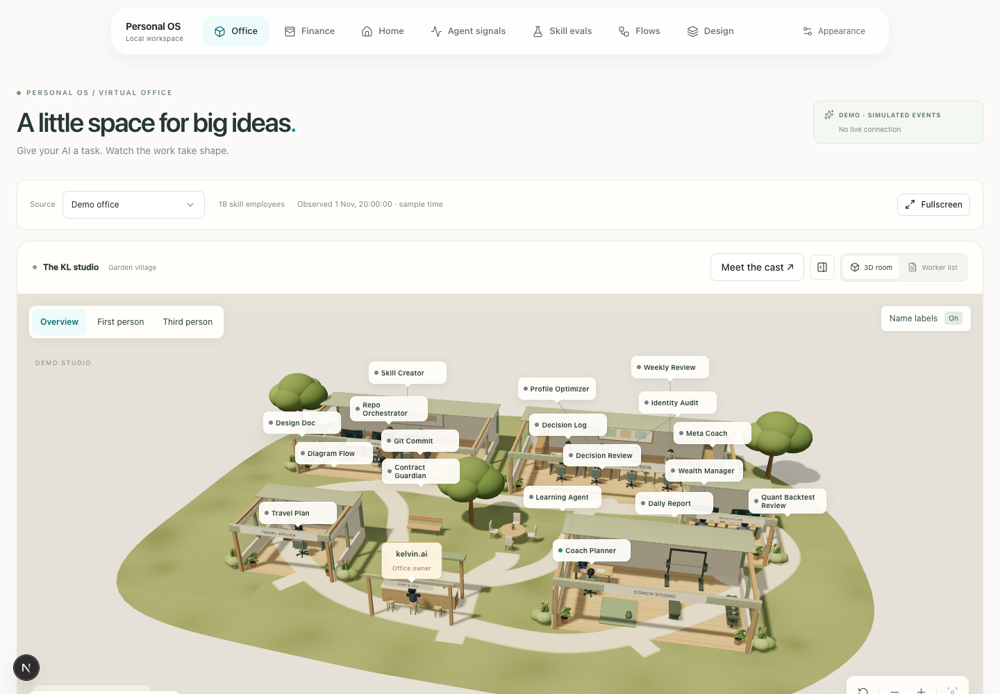
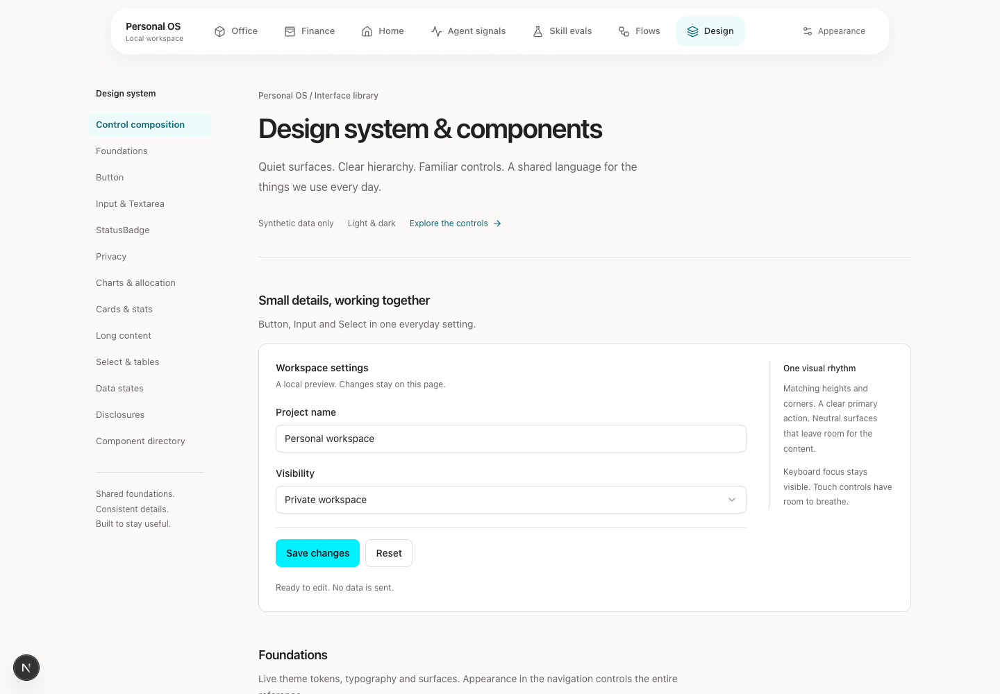

# Personal-OS

A personal management system: structured logs, a logic engine and AI agents drive data-driven self-management.

> Architecture: [ARCHITECTURE.md](ARCHITECTURE.md) | Direction: [docs/VISION.md](docs/VISION.md) | Collaboration rules and full directory tree: [AGENTS.md](AGENTS.md)

## Core Loop

```
Brain Dump → /daily-report → logic-engine alerts → /coach-planner → daily schedule
                ↑                                        ↑
       COROS official MCP (on demand)              /weekly-review
```

## Directory Map

[AGENTS.md](AGENTS.md) is the only owner of the full directory tree (`make doctor` validates it line by line). This is an entry map only.

| Path | Purpose |
|------|---------|
| `.agents/skills/` | Agent skills, see [Claude Code Skills](#claude-code-skills) |
| `config/` | Public regulatory and pipeline settings; personal thresholds live in `data/config/` |
| `market/` | Externally observable market facts (rates, FX, jobs); public |
| `data/` | 🔒 Your own private repo, ignored by this one: logs, config, decisions, finance, profile |
| `scripts/` | Python automation (rules, evidence validation, weekly aggregation, doctor) |
| `web/` | Local Next.js app, localhost only, see [Web App](#web-app) |
| `repos/` | External project submodules |
| `docs/` | [README](docs/README.md), INDEX routing, VISION (direction), ROADMAP (open work), DECISIONS (settled), knowledge notes |
| `templates/` · `tests/` | Blank templates / unit tests |

## Quick Start

> First time here, or want an agent to guide the setup? Read [SETUP.md](SETUP.md). Its top comment block is an interactive bootstrap script for the agent.

```bash
git clone https://github.com/KelvinYou/personal-os.git
cd personal-os
git submodule update --init repos/ai-stock-analysis repos/notes   # as needed
make setup      # create .venv and install dependencies
make doctor     # environment self-check
```

Create your own **private** Git repo (an empty one is fine), then run
`make setup-private DATA_REPO=<your private repo URL>`. This clones it into `data/`
and copies the config examples for you to personalize. Review
`data/config/thresholds.yaml` and `data/config/settings.yaml`, set each file's
`owner_configured` to `true`, fill in `data/user_profile.md`, then run `make doctor`.
If `data/` already has files, the command refuses to overwrite them; move them
into your private repo first. This repo never records your private repo URL or commit.

Common commands (purpose only; the full list is in [AGENTS.md](AGENTS.md#common-commands)):

| Command | Purpose |
|---------|---------|
| `make today` | Generate today's log template |
| `make coros-health` | Evaluate official MCP evidence from stdin; no daily-log writes |
| `make sync-calendar WEEK=YYYY-w##` | Explicitly sync Google Calendar for the given week |
| `make check` | Run logic-engine alerts on local logs |
| `make weekly` / `make report` | Weekly aggregation / lint + logic check + synthesis, then prepare the prompt for an AI-written report |
| `make wealth` | Tracked Assets: cash, maturities, rates and stock valuation |
| `make web` | Local web app |
| `make test` / `make lint` | Unit tests + web typecheck / log lint |
| `make kb-check` / `make kb-index` / `make kb-eval` / `make kb-graph` | Knowledge-note contract / catalog / retrieval eval / Mermaid view |
| `make archive` | Fold logs outside the 90-day hot window |
| `make decisions-due` / `make decision-new` | List decisions due for review / create a decision entry |
| `make calibration` | Decision calibration analysis |
| `make quarterly` | Quarterly identity audit |

COROS uses the official OAuth MCP connector in your AI client. Follow
[the official setup guide](https://support.coros.com/hc/en-us/articles/50841795180948-Connect-Your-COROS-to-AI)
and [the integration contract](docs/design/coros-official-mcp.md). No COROS password
or internal Python client is required. `make check` and plain `make weekly` inspect
local recorded evidence only; skills pass live MCP evidence to Python on demand.

Logic-engine thresholds live in your private `data/config/thresholds.yaml`; the public example is `templates/thresholds.example.yaml`.
The four-dimension scoring framework (Output / Health / Mental / Habits) is defined in the weekly-review skill.
The wealth module currently targets Malaysia and MYR/USD; COROS, Calendar and the stock pipeline are enabled on demand.

## Web App

`web/` is a local-only Next.js app: the Tracked Assets dashboard, the virtual office and design references.


*`/office` in demo mode: one skill employee per workspace.*


*`/design-system`: the local interface library, synthetic data only.*

```bash
cd web && npm install   # first run only
make web                # same as cd web && npm run dev
make office             # loopback-only (127.0.0.1:3000); demo mode needs no private config
make flows              # regenerate web/public/flows.json for /flows
```

| Route | Shows |
|---|---|
| `/` | Tracked Assets dashboard |
| `/finance` | Balance-sheet view and editing |
| `/office` | Virtual office, plus `/office/team`, `/office/collaboration`, `/office/characters` |
| `/home-design` | Home design preview |
| `/flows` | Makefile, script and submodule flow graph |
| `/design-system` | Local interface design reference |
| `/skill-regressions` | Skill regression evidence |
| `/eval-rollup` | Monthly agent-signal rollup |

Rules that keep the app safe and consistent:

- **Local only, never deploy.** It reads Tracked Assets (not full net worth) from your private `data/` repo, and `repos/ai-stock-analysis` is public. The isolation is intentional (see [ARCHITECTURE.md](ARCHITECTURE.md) §4). Any deployment must first solve the hosting boundary for private data.
- **The page does not compute.** Every number comes from `scripts/wealth_check.py --json`, the same code `make wealth` runs, and `web/lib/report.ts` only spawns it, parses the JSON and renders. To change a definition, edit `scripts/lib/wealth/`; the CLI and web change together.
- **Shared components are copied, not imported.** `web/components/shared/` is copied from `repos/ai-stock-analysis/web/components/shared/`. The repos differ in visibility, and a compile-time dependency would let a public-repo change break this private app.
- **Balance-sheet scope.** Finance renders report v4: gross tracked assets, known outstanding MYR debt, recorded monthly commitments and assets after known debt. Missing loan balances stay unknown, so the adjusted figure is not full net worth. Credit-card `outstanding` requires `as_of`; `statement_due` and `payment_due_date` describe a separate payment obligation. Monthly installments are not deducted from assets. Optional private `data/finance/travel-cash.yaml` wallets are shown in CNY without conversion and excluded from MYR totals. History and allocation keep their gross-asset basis.
- **Interface design** follows [the shared design guide](docs/design-system.md); the dashboard is the visual baseline for standalone HTML such as travel exports. Before changing any 3D scene, camera or movement control, read [docs/design/3d-scene-standard.md](docs/design/3d-scene-standard.md).

Tests: `make test` runs Python tests, web typecheck and Vitest. `make test-browser` runs Playwright against an isolated dev server and is not part of `make test`; run it before and after any 3D movement or camera change.

## Claude Code Skills

| Command | Purpose |
|---------|---------|
| `/daily-report` | Turn a brain dump into a structured daily log |
| `/weekly-review` | Weekly synthesis and next-week objectives |
| `/coach-planner` | Coach-style scheduling and real-time decision support |
| `/wealth-manager` | Portfolio analysis, buy-the-dip timing, net-asset summary |
| `/learning-agent` | AI-era skill radar and learning plan |
| `/decision-log` | Capture decisions |
| `/decision-review` | Review decisions and calibrate |
| `/meta-coach` | Monthly audit of the agent's advice quality |
| `/identity-audit` | Quarterly behavior vs. claimed identity audit |
| `/profile-optimizer` | Rewrite LinkedIn / portfolio copy and ordering from JD data |
| `/contract-guardian` | Semantic-contract review for cross-layer changes (schema / scripts / docs) |
| `/quant-backtest-review` | Adversarial review of ai-stock-analysis backtests and signal code |
| `/repo-orchestrator` | Multi-repo coordination: submodule sync, integration checks, pre-commit gate |
| `/skill-creator` | Create, optimize and eval skills (upstream open-source skill, not maintained here) |

`/git-commit` and `/diagram-flow` moved to [agent-toolkit](https://github.com/KelvinYou/agent-toolkit) and install as a plugin:

```
/plugin marketplace add KelvinYou/agent-toolkit
/plugin install agent-toolkit@agent-toolkit
```

## Dependencies

`requirements.txt` is the only owner of the dependency list. `make setup` installs it; `make doctor` verifies the venv, private data, the stock-price pipeline and web dependencies. COROS uses client-managed OAuth; the web app additionally requires `cd web && npm i`.
