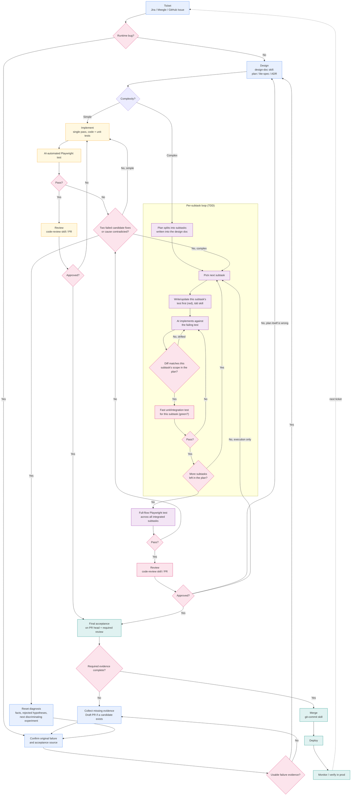

# Feature / Bug-Fix SOP

Day-to-day dev loop: ticket intake to deploy. Splits into a simple path and a
complex path right after Design — complexity decides how much structure the
implementation phase needs, not whether design/test/review happen at all.

## Reading it

- **Complexity is decided once, right after Design** — not per-subtask. If the
  plan turns out to need splitting mid-flight, that's a sign Design
  under-scoped it; treat it as a plan revision (`E8A` "plan itself is wrong"
  loops back to **B**, not around the loop).
- **Simple path**: one implementation pass, one test gate, one review gate.
  This is the default — don't route a change through the subtask loop unless
  it actually needs it. For bugs, both paths first establish original-failure
  evidence. A claimed known cause does not waive that step.
- **Complex path — the per-subtask loop is TDD, not implement-then-check**:
  write/update that subtask's test first (`E2T`, `tdd` skill) so the AI
  iterates against a concrete red→green signal, not just "looks right."
  Check the diff against the plan (`E4`) before running the test, and only
  pull the next subtask once the current one is green. This catches scope
  drift per-subtask instead of discovering it after everything's implemented.
- **Two test gates, different speeds**: `E5` is a fast unit/integration test
  run per subtask — deliberately not Playwright, since E2E is too slow to run
  inside a tight per-subtask loop. `E7` is the one full Playwright E2E pass,
  run once after all subtasks are integrated — a subtask can pass alone and
  still break when combined with the others, so this gate exists even though
  each subtask already passed `E5`.
- **Review failure branches by cause** (`E8A`): "execution didn't match an
  otherwise-correct plan" loops back into the subtask loop; "the plan itself
  was wrong" goes all the way back to Design. Don't reflexively send every
  review rejection back to Design.

## Bug acceptance contract

Before editing, record the trigger, actual result, expected result, environment,
and acceptance source (issue, requirement, API contract, or confirmed existing
behavior). Resolve conflicting sources explicitly. Preserve UI and business
behavior outside the intended fix; list unrelated improvements separately.

For runtime bugs, use a failing test, original-flow recording, request/response
replay, or targeted execution trace. Static evidence alone can establish a
static defect; it cannot establish that a runtime symptom is resolved. Reuse
valid evidence when its inputs, versions, and environment have not changed.

Choose a regression test that reaches the original failure mechanism. When
automatable, run the same acceptance test before and after the fix: it must fail
because of the original defect and pass after the fix. Assert observable
behavior, including the relevant error, retry, cancellation, or race. A test
that only mirrors a helper's implementation does not establish acceptance.
Rerun the original full scenario after the focused test passes.

Mocks must derive expectations from an independent contract or confirmed
behavior, with provenance. Do not infer backend acceptance from frontend output.
If old and new clients share a helper, equality between them alone cannot prove
parity; retain an independent expected payload or behavior. Changing a test
expectation requires a stated contract correction, not merely matching the fix.
Never weaken assertions, skip required checks, or suppress failures to obtain green.

## When the original failure cannot be reproduced

Record attempted reproduction, observed results, and the missing input, access,
version, device, or timing evidence. Continue safe evidence collection: capture
a narrow trace, replay a sanitized real response, compare versions, or improve
the reproduction rate of an intermittent failure. Avoid collecting credentials
or unrelated personal data.

If evidence still cannot distinguish the cause, report the precise missing
artifact or access needed. Do not keep adding speculative patches. An existing
candidate may be submitted as a Draft PR with the original acceptance marked
unverified; it is not ready to merge. Resume diagnosis when new evidence arrives.

## When candidate fixes repeatedly fail

After two candidate fixes fail the original acceptance, or decisive evidence
contradicts the proposed cause earlier, pause further patching and return to
diagnosis (`F` → `H` → `R`). This is a workflow checkpoint, not a claim that two
attempts have statistical significance. Ordinary red/green implementation
iterations and setup failures are not separate failed candidate fixes.

Record known facts, rejected hypotheses and their evidence, remaining hypotheses,
and the next experiment that distinguishes them. Vary one relevant factor at a
time. Preserve user work and useful evidence; do not reset or discard changes.
Resume implementation once the experiment supports a cause and the acceptance
test reaches it. An incorrect acceptance contract returns to Design as well.

## Final evidence and PR readiness

On the final PR head, rerun the original scenario and affected regression checks.
Record the full SHA, commands or manual steps, results, and evidence locations.
For cross-repository integration record both versions; for native behavior record
the device/OS and build. Any subsequent relevant code, configuration, input, or
environment change invalidates affected results and requires a rerun. If using a
CI merge-result commit, record that SHA and its relation to the PR head/base.

Report mock, real-response replay, backend integration, and device verification
separately. Existing unrelated baseline failures remain visible with evidence;
subset success does not mean the whole application passed. Each unverified item
must state its effect on acceptance. Missing or failed required acceptance keeps
the PR Draft and blocks merge; unrelated checks follow the repository's existing
policy. Do not claim release or production recovery from local verification.

Money, permissions, duplicate transactions, and session-isolation changes require
an independent acceptance review against the source requirement. Another AI can
assist that review, but its agreement does not replace execution evidence.

Use this handoff shape:

| Item | Required evidence |
| --- | --- |
| Original problem | Trigger, actual/expected behavior, acceptance source |
| Cause | Supporting observation and discriminating experiment |
| Before / after | Same regression check plus original full scenario |
| Verification version | Final SHA, environment/build, counterpart versions |
| Remaining gaps | Unverified items, acceptance impact, Draft/ready status |
| Delivery | PR link and independently reviewed acceptance where required |

These are agent workflow instructions and review criteria. They do not install
CI checks or branch protection; repository automation must enforce any required
merge checks separately.
